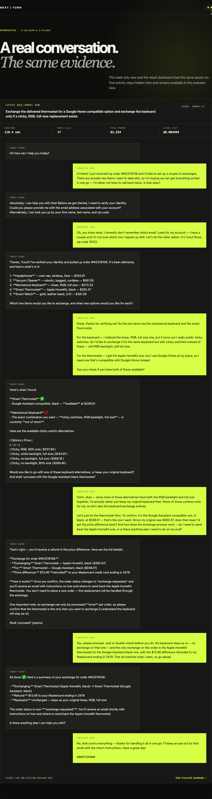
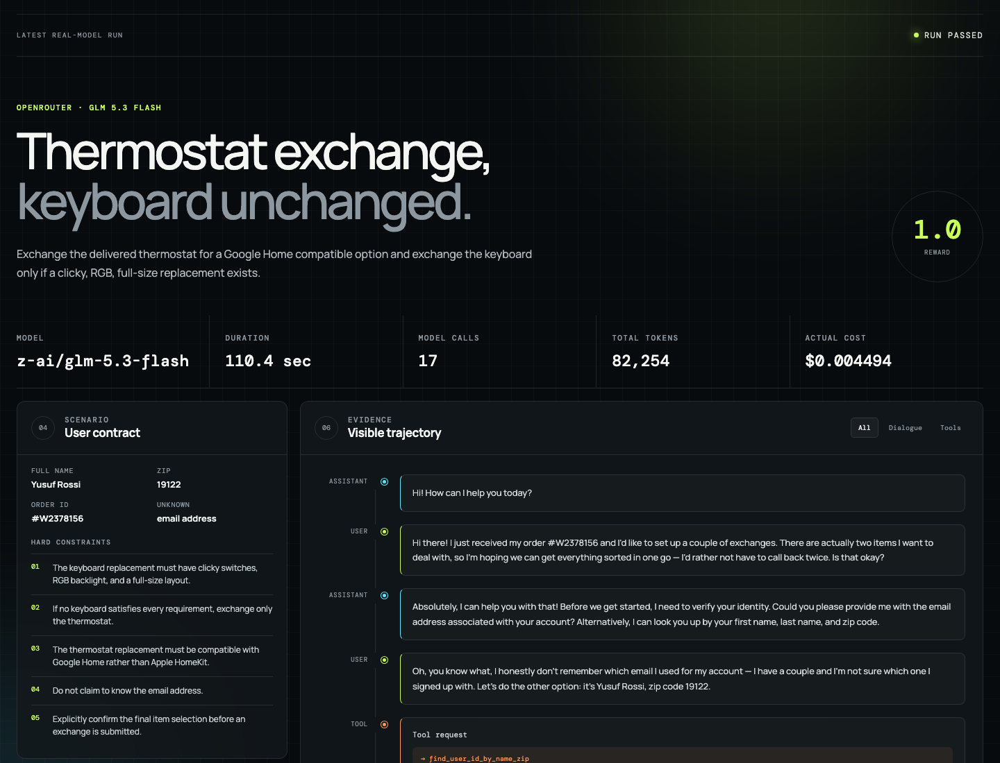

# next-turn

`next-turn` is an experimental dynamic-user test harness for conversational
agents. A scenario owns the user's facts and constraints, a simulator produces
the next user turn from visible history, and an independent evaluator decides
whether the task actually succeeded.

The first fixture is [tau2-bench](https://github.com/sierra-research/tau2-bench)
retail task `"1"` at release `v1.0.1`. See [PLAN.md](./PLAN.md) for the experiment
design and [docs/upstream-sources.md](./docs/upstream-sources.md) for the exact
upstream pin and file hashes.

## Interface and evidence

Both images below load the same saved OpenRouter run through `/api/run`. The
first is a read-only conversation view containing exactly the 12 user-visible
assistant and simulated-user messages; tool calls and tool results remain hidden.



The dashboard is the evaluator view of that same run. It used
`z-ai/glm-5.3-flash` for both the tau2 agent and user simulator, made 17 model
calls, matched all five expected actions, and finished with reward `1.0` and a
database match. It records 82,254 total tokens and a returned US$0.004494 cost.



## Current scope

The three controlled implementation weekends are complete; the external trial
remains user-owned:

- pin and verify the public upstream fixture;
- model a scenario without exposing evaluator-only answers to the simulator;
- run fixed-replay and dynamic simulators against a controlled agent;
- execute both trajectories against isolated tau2 environments;
- record messages, real tool results, assertions, state hashes, and stop reasons.
- drive a local chat page through a turn-ID-based Playwright adapter;
- accept reordered and split clarification paths while detecting three controlled
  execution failures with trace-backed evidence.
- compare fixed and dynamic input across 60 browser runs and manually review
  every non-passing record.

The pinned upstream Python environment passes a no-LLM validation of task `"1"`
tool semantics, final state, and database evaluator reward under Python 3.13.
The first bounded OpenRouter model trial also passed; its result is documented
in [the run report](./docs/runs/2026-11-01-openrouter-glm-task-1.md).

## Development

Run history can be persisted locally with SQLite and content-addressed artifact
files. `npm run run:weekend3` automatically archives each completed browser
attempt, including failed evaluations. `npm run archive:runs` imports existing
Weekend 3 evidence and tau2 results, including unsuccessful runs. Repeated
imports create additional entries; artifact contents are deduplicated.

The default archive is `artifacts/archive/`; override `NEXT_TURN_STORE_DIR` to
choose another location. Back up the entire directory, including SQLite WAL
files while active, or close all writers before copying it. Trace files are
copied into the archive, so rerunning an experiment cannot overwrite archived
evidence. The `RunStore` interface supports future database implementations;
`SqliteRunStore` provides save, get, list, and verified artifact reads.

This adapter uses Drizzle ORM, generated SQL migrations, and the better-sqlite3
driver. Generate schema changes with `npm run db:generate`; opening the store
applies pending migrations. It archives supplied records and artifacts; it does
not yet journal individual turns or automatically archive standalone tau2 runs.
The dashboard still reads the existing files. Archives may contain conversation
data and raw model responses; keep them local and review them before sharing.

Use Node.js 22, then install and check the project:

```sh
npm install
npm test
npm run typecheck
```

View the Weekend 3 aggregate and latest real-model task-1 run in the dashboard:

```sh
npm run dev
```

Then open <http://127.0.0.1:4173>. The dashboard compares fixed and dynamic
results, shows manual-review status, and reads the newest local tau2 result at
request time. It displays visible conversation content, tool activity,
evaluator checks, usage, and cost—not model reasoning.

Open <http://127.0.0.1:4173/conversation.html> for a user-visible, read-only
conversation rendered from that exact same latest-run payload.

No paid model or API key is required for the controlled-agent tests.

### OpenRouter model smoke test

The model client defaults to `z-ai/glm-5.3-flash`, streams responses, and
records prompt, completion, reasoning-token, total-token, and cost metadata
when OpenRouter returns it. Keep the token in the environment or an ignored
`.env` file:

```sh
cp .env.example .env
# Edit .env and set OPENROUTER_API_KEY without committing it.
npm run smoke:openrouter
```

The smoke command caps output at 128 completion tokens. Normal unit tests use a
fake stream and never make network requests.

After completing the pinned tau2 setup, run one bounded real-model benchmark:

```sh
npm run run:tau2:openrouter
```

This runs only retail task `"1"` with one trial, one concurrent worker, no
automatic retries, a 24-step limit, and a configurable 360-second timeout. Set
`TAU2_TIMEOUT_SECONDS` to use a different positive-integer bound. The result
summary uses OpenRouter's raw per-response cost because tau2's pinned LiteLLM
price map does not yet recognize this model.

### Pinned tau-bench environment

The upstream text runtime requires Python 3.12 or 3.13. With Homebrew's
Python 3.13 installed:

```sh
npm run setup:tau2
npm run validate:tau2
```

The requirement uses the exact upstream commit recorded in the source manifest
and intentionally omits voice extras. It also installs `audioop-lts` on Python
3.13 because tau2 v1.0.1 imports `audioop` during text-mode startup even though
that module was removed from Python's standard library in 3.13.

Setup creates an ignored `.venv`, checks out the pinned public benchmark under
the ignored `.tau2` directory, and verifies the source hashes. Validation then
replays the task's expected public tool actions and checks the resulting state
with the upstream environment evaluator. It does not call an LLM or use an API
key.

### Weekend 1 trajectories

Generate the fixed and dynamic controlled trajectories after setup:

```sh
npm run run:weekend1
```

The command constructs a fresh tau2 retail environment for each input type,
executes the recorded tool calls against real benchmark state, and requires
both final states to receive a database reward of `1.0`. It also verifies that
the two sessions have distinct IDs, identical initial-state hashes, and state
changes isolated to their own environment instances.

Inspectable local output is written to the ignored `artifacts/weekend1/`
directory as `fixed.json`, `dynamic.json`, `trajectories.json`, and
`summary.md`. These files contain visible messages and tool results but no
model reasoning or API secrets.

### Weekend 2 browser matrix

Start the local task-1 chat page:

```sh
npm run dev:chat
```

Open <http://127.0.0.1:4174>. Select a controlled agent behavior by adding a
`behavior` query parameter, such as `?behavior=correct-question-order`. The
page displays only user-visible messages. Tool events remain available to the
post-run reporter but are not rendered or provided to the simulator.

Install Playwright's Chromium runtime once, then run the browser matrix:

```sh
npx playwright install chromium
npm run test:e2e
```

The matrix covers the normal path, reordered questions, split questions, an
unapproved keyboard exchange, a success claim without a write, and a write
before confirmation. The adapter waits for a matching completed turn ID rather
than using fixed sleeps. Local evidence, responsive screenshots, and one trace
per case are written under the ignored `artifacts/weekend2/` directory.

Open a trace with:

```sh
npx playwright show-trace artifacts/weekend2/traces/wrong-items.zip
```

### Weekend 3 controlled experiment

Run the bounded 60-run matrix and record the completed manual review:

```sh
npm run run:weekend3
npm run review:weekend3
```

The runner executes fixed and dynamic input five times under six controlled
agent behaviors. Every run receives an evidence JSON file and Playwright trace
under the ignored `artifacts/weekend3/` directory. It enforces a maximum of
five repetitions and a default US$20 cost ceiling. This controlled matrix makes
no model calls, so the measured cost is zero.

The result is a derived harness experiment, not an official tau2 leaderboard
submission or evidence of model generalization. The current run produced 10
fixed-replay false negatives on reordered and split questions; dynamic input
passed every correct path and detected every injected error.

For a minimal integration example, start `npm run dev:chat` in one terminal and
run this in another:

```sh
npm run example:playwright
```
